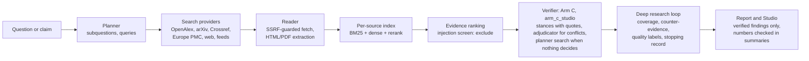
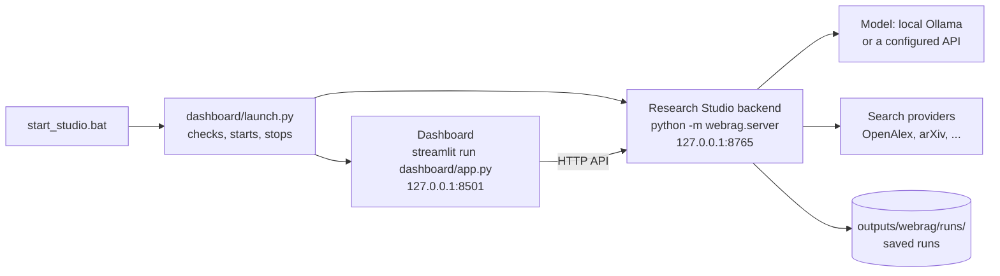

# Multi-Agent RAG — Research Studio (local)


An M.Tech research project on retrieval-augmented generation that checks its own claims, run as a **local application
on your own computer**. Its **Research Studio** plans searches, reads scholarly and web sources, ranks passages, and
has every drafted statement checked passage by passage against the retrieved text by a language model. It reports
only what that check supports, and shows the sources, passages, conflicts and limits of the search.

By default the model is `qwen3:4b` running in Ollama on your computer. The verdicts are judgements by a language model
about the retrieved text, not proof that a statement is true, and they were evaluated with `qwen3:4b` only.

## Quick start (Windows)

```text
py -3.12 -m venv .venv
.venv\Scripts\python.exe -m pip install -r requirements.txt
ollama pull qwen3:4b
.\start_studio.bat
```

The launcher checks the setup, starts both parts and opens the dashboard:

| | Address | What it is |
|---|---|---|
| **Dashboard** | http://127.0.0.1:8501 | Streamlit command center: health, research workspace, library, evidence explorer, model settings, diagnostics |
| **Research Studio** | http://127.0.0.1:8765 | the original Studio interface and the backend (API, job queue, pipeline) that the dashboard talks to |

In PowerShell keep the leading `.\`; in `cmd` it is optional. Both listen on `127.0.0.1` only. Stop both with **Ctrl+C** in the launcher window.

## Public project showcase

`showcase/app.py` is a separate, static website about the project: an overview, an architecture explorer computed
from the source code, the research workflow with recorded demonstrations (links only, no third-party text), the
historical Phase 11B benchmark read from the repository's result files, an exploratory engineering diagnostic
(aggregate counts only), and these installation instructions; every result is labelled with its kind of evidence. It runs no model,
starts no research, contacts no service and needs no account, so it can be hosted for free:

* Streamlit Community Cloud: main file path `showcase/app.py`, Python 3.12; dependencies come from
  `showcase/requirements.txt` (Streamlit and its pyarrow pin).
* Locally: `.venv\Scripts\python.exe -m streamlit run showcase/app.py`

The showcase is not the application: research runs only in a local installation (above). How the recorded examples
were made safe to publish: `showcase/make_examples.py`.

## How it works



* **Planner** writes the search queries; the **web researcher** reads the sources it can reach (network access is
  guarded against private addresses and pinned to checked addresses); the **synthesizer** drafts cited statements;
  the **verifier** judges each statement against each retrieved passage (SUPPORTS / CONTRADICTS / NEUTRAL, with the
  sentence it relies on).
* **Default verifier: Arm C agentic verification, Studio-adapted variant (`arm_c_studio`).** It runs the frozen code of
  the agentic verification study's arm C (`docqa/agentic.py` over `evaluation/experiments/agentic_verify/`):
  * one verifier call judges the passages;
  * unanimous evidence decides;
  * passages for and against go to an adjudicator, which may decide one side; the statement is then marked
    *adjudicated*, both sides stay listed, and a supported statement stays out of the direct answer and summary;
  * when no passage took a side, a planner may search this run's evidence (at most 2 searches) before adjudication;
  * failures are reported (service error, unusable output, a failed search), never replaced by another verifier.
  * The one difference from the historical method (`arm_c`, also selectable): an adjudicator decision with no passage
    for or against the claim is not accepted.
* **Historical result, not Studio performance.** On 188 SciFact development claims that earlier project systems had
  already used, Arm C reached macro-F1 0.7551 against 0.7153 for the single-pass rank baseline:
  * difference +0.040, 95% interval −0.004 to +0.085, permutation p = 0.081 (not significant);
  * arm C0, without the planner's search, scored 0.7576;
  * false support rose from 10/64 to 13/64.
* **The Studio's own accuracy with Arm C has not been evaluated.** The previous default, `quote_stance` (conflicting
  evidence stays INSUFFICIENT), stays available as a fallback.
* Deep research adds bounded search rounds, coverage per subquestion, counter-evidence searches, evidence-quality
  labels (single source, abstract only, independence unknown), deterministic cautions and a recorded reason for
  stopping.

## What is implemented, and what is experimental

| Capability | Status |
|---|---|
| Research and claim verification, deep research, Studio, saved reports, Markdown/JSON export | implemented, tested offline |
| Network safety: scheme/port/host checks, every DNS answer checked, connection pinning, verified TLS | implemented, tested offline |
| Whole-token number check for sentences in the generated summary | implemented, on by default |
| Injection screen (`WEBRAG_INJECTION_GUARD`, `exclude` by default): withholds retrieved text that looks like injected instructions | on by default; no benign passage flagged on two held-out corpora; misses paraphrased attacks |
| Quote attestation (`WEBRAG_QUOTE_ATTESTATION`): records where each verifier quote sits in its passage | on by default for quoting verifiers; record only, never changes a verdict |
| Arm C agentic verification (`arm_c_studio`, the default; `arm_c` historical; `arm_c0`) | default since this version; implemented and tested offline, one live local check; **not evaluated on the Studio's web evidence** (0.7551 is a historical SciFact result) |
| `quote_stance` (the previous default): conflicting evidence stays INSUFFICIENT | available with `WEBRAG_VERIFIER=quote_stance`; evaluated on the project's web claim sets |
| `--verifier quote_stance_ranked` or `WEBRAG_VERIFIER`: conflicting evidence is decided by the first-ranked passage with a stance (no extra model call) | experimental opt-in, implemented and tested offline; **not evaluated in the Studio** (the rule comes from a SciFact study) |
| `--verifier quote_stance_adjudicated`: an LLM settles conflicting evidence | experimental, **not recommended** (raised false support in exploratory runs) |
| `webrag/source_status.py`: retraction-status contract | offline contract only; no live lookup exists |

## How the pieces fit



* The **Research Studio** (`webrag/`) is the application: its server runs research and verification jobs, saves runs and
  serves the original Studio interface (`webrag/ui.html`, `webrag/static/`).
* The **dashboard** (`dashboard/`) is a client of the Studio's API. It starts real runs in the Studio's job queue,
  follows their stages, and reads saved runs, findings, passages, sources and coverage. Every page has an
  *Open Research Studio* button for the full Studio interface. If the Studio is not running, the dashboard says so.

## Prerequisites

* Windows 10/11 x64 and **Python 3.12** (`py -3.12 --version`). The pinned packages are for Python 3.12 on Windows.
* **Ollama** (https://ollama.com) with the model: `ollama pull qwen3:4b`. Without Ollama the Studio and dashboard still
  start, show saved reports and say that the model is not reachable.
* Internet access for the search providers. The first research run downloads the two retrieval models
  (`all-MiniLM-L6-v2`, `cross-encoder/ms-marco-MiniLM-L-6-v2`, about 180 MB) into the Hugging Face cache.
* Node.js only to run the interface tests.

## Install (once)

```text
py -3.12 -m venv .venv
.venv\Scripts\python.exe -m pip install -r requirements.txt
```

`requirements.txt` lists the direct dependencies; `requirements-lock.txt` pins every package for Windows x64 /
Python 3.12 (`pip install -r requirements-lock.txt` reproduces the tested environment exactly).

## Configure the model (optional)

Nothing needs configuring for the default (local Ollama, `qwen3:4b`). To change it, copy `.env.example` to `.env`
(ignored by git) and edit it, then restart the launcher:

```text
copy .env.example .env
notepad .env
```

* Another local model: `WEBRAG_LLM_MODEL=llama3.2:3b` (pull it in Ollama first).
* An OpenAI-compatible API or an Ollama server elsewhere: set `WEBRAG_LLM_PROVIDER` (`openai` or `ollama`),
  `WEBRAG_LLM_BASE_URL` (`https://...`), `WEBRAG_LLM_MODEL` and, if needed, `WEBRAG_LLM_API_KEY`. Prompts, questions
  and retrieved passages are then sent to that service. The key stays in the Studio server process; the interfaces
  show only whether it is set.
* If the configured model is unavailable, a run stops with that reason; no other model or provider is substituted.
* Verification options: `WEBRAG_VERIFIER` (`arm_c_studio` by default; `quote_stance` restores the previous default, which
  leaves conflicting evidence undecided; `arm_c`, `arm_c0`, `quote_stance_ranked` and
  `quote_stance_adjudicated` are alternatives),
  `WEBRAG_INJECTION_GUARD` (`exclude` by default, `flag`, `off`) and `WEBRAG_QUOTE_ATTESTATION` (on by default when
  the verifier quotes; `0` turns it off). These are fixed when the Studio starts; a run request cannot change them.
  The launcher prints what it will use, an invalid value stops the start, and a `python -m webrag.server` flag wins
  over the setting.

The dashboard's *Model & Integrations* and *Settings & Diagnostics* pages show what is in use and whether it works.

## Launch and stop

```text
.\start_studio.bat                                      # both parts, opens http://127.0.0.1:8501
.\start_studio.bat --no-browser                         # without opening a browser
.\start_studio.bat --studio-port 8766 --dashboard-port 8502
.\start_studio.bat --check                              # only check the setup
```

`start_studio.bat` runs `.venv\Scripts\python.exe -m dashboard.launch`. Stop with **Ctrl+C** in its window; the
launcher stops both parts. Each part can also be run on its own:

```text
.venv\Scripts\python.exe -m webrag.server                     # Research Studio only, http://127.0.0.1:8765
.venv\Scripts\python.exe -m streamlit run dashboard/app.py    # dashboard only (needs the Studio running)
.venv\Scripts\python.exe -m webrag "a research question"      # command line, no interface
.venv\Scripts\python.exe -m webrag --verify "a claim"
```

Runs are saved under `outputs/webrag/runs/` (not versioned: they contain fetched web text). Full Studio options,
network-safety details and known gaps: `webrag/README.md`.

## Troubleshooting

| Problem | What to do |
|---|---|
| `No virtual environment found` | create it: `py -3.12 -m venv .venv`, then install the requirements |
| `Missing packages: ...` | `.venv\Scripts\python.exe -m pip install -r requirements.txt` |
| `Ollama is not reachable` | start the Ollama app; `ollama list` should answer |
| `qwen3:4b is not installed` | `ollama pull qwen3:4b` (or set another installed model in `.env`) |
| `Port 8765/8501 is used by another program` | close that program, or `.\start_studio.bat --studio-port 8766 --dashboard-port 8502` |
| `Configuration problem: ...` | fix the named setting in `.env` (see `.env.example`) |
| dashboard shows *Studio backend is not running* | start with `.\start_studio.bat`, or start `python -m webrag.server` and reload |
| first run is slow or fails while loading models | the retrieval models are downloaded once; check the internet connection |
| a search provider fails (for example OpenAlex `429`) | the run continues with the others and lists the error; `OPENALEX_API_KEY` in `.env` avoids the shared budget |

## Tests

Offline, no model and no network:

```text
.venv\Scripts\python.exe -m pytest -q
node --test tests/js/*.test.mjs
```

Repository layout and which files the application needs: `docs/REPOSITORY_STRUCTURE.md`.

## Limits

* A 4B local model drafts and judges the statements; it makes mistakes. The verifier's quote check is tolerant: an
  exploratory replay found that some accepted quotes are not contiguous text of their passage (for example numbers
  mis-copied), which is why quote attestation exists and why it does not change verdicts yet.
* Search coverage depends on what the providers return and what can be read (many sources are abstract-only).
* The Studio and dashboard are local tools: they bind to 127.0.0.1, have no authentication and are not meant to
  be exposed to a network.

## Not included in this public release

The thesis drafts and their study code, the evaluation command line and its held-out claim sets, evaluation run
records, and other unpublished research material are kept private. Some documents refer to these by path; those
references are not available here.

## License

The project's own code and documentation are released under the MIT License (see `LICENSE`).

The MIT License does not cover third-party material in this repository, which keeps its own terms:

* `data/scifact/` — the SciFact dataset (claims and a corpus of scientific abstracts) by its original authors. Use it
  under the dataset's own licence and citation requirements, published with the dataset; this repository has not
  verified those terms.
* Titles, abstracts and other text of third-party publications that appear in data files or test fixtures remain
  the property of their authors and publishers.
* The Python packages in `requirements.txt` and `requirements-lock.txt` are not bundled; each is distributed under
  its own licence.

## Research codebase

The repository also contains the project's earlier research backend (`research_*.py`, `rag.py`,
`claim_verification.py`, `experiment_b_verification.py`, `evidence_core/` and the baseline benchmark scripts), which
the application builds on. `ARCHITECTURE_DECISION_VERSION_BOUNDARIES.md` records which modules are frozen.
