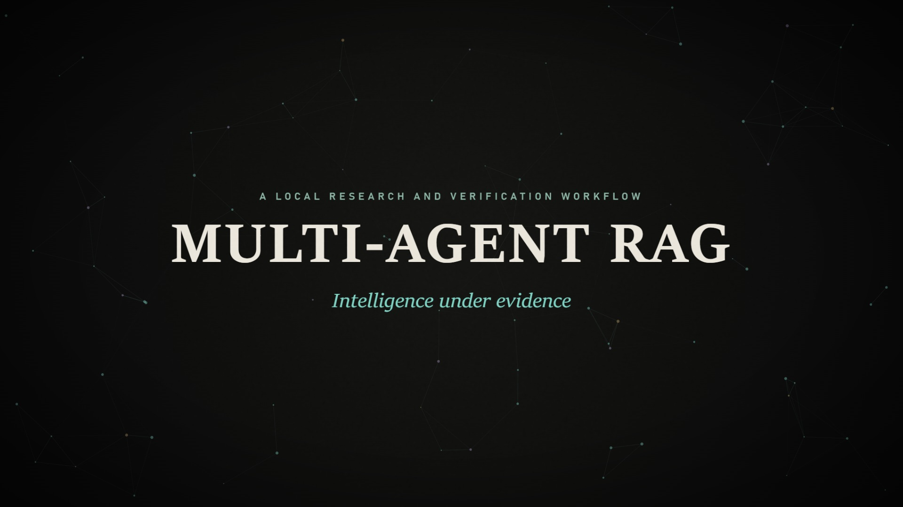
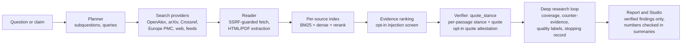

# Multi-Agent RAG — evidence-grounded research and claim verification



An M.Tech research project on retrieval-augmented generation that checks its own claims. Its main application, the
**Research Studio**, plans searches, reads scholarly and web sources, ranks passages, and has every drafted statement
checked passage by passage against the retrieved text by a local model. It reports only what that check supports,
and shows the sources, passages, conflicts and limits of the search instead of hiding them.

Everything runs against a local model (`qwen3:4b` through Ollama). The verdicts are judgements by a 4B model about the
retrieved text, not proof that a statement is true.

## How it works



* **Planner** writes the search queries; the **web researcher** reads the sources it can reach (network access is
  guarded against private addresses and pinned to checked addresses); the **synthesizer** drafts cited statements;
  the **verifier** judges each statement against each retrieved passage (SUPPORTS / CONTRADICTS / NEUTRAL, with the
  sentence it relies on).
* A statement is **SUPPORTED** when at least one passage supports it and none contradicts it, **CONTRADICTED** when a
  passage contradicts it and none supports it, and **INSUFFICIENT** otherwise — including when passages disagree.
* Deep research adds bounded search rounds, coverage per subquestion, counter-evidence searches, evidence-quality
  labels (single source, abstract only, independence unknown), deterministic cautions and a recorded reason for
  stopping.

## What is implemented, and what is experimental

| Capability | Status |
|---|---|
| Research and claim verification, deep research, Studio, saved reports, Markdown/JSON export | implemented, tested offline |
| Network safety: scheme/port/host checks, every DNS answer checked, connection pinning, verified TLS | implemented, tested offline |
| Whole-token number check for sentences in the generated summary | implemented, on by default |
| `--injection-guard flag\|exclude`: screens retrieved text for injected instructions | opt-in; misses paraphrased attacks |
| `--quote-attestation`: records where each verifier quote sits in its passage | opt-in, record only; never changes a verdict |
| `--verifier quote_stance_adjudicated`: an LLM settles conflicting evidence | experimental, **not recommended** (raised false support in exploratory runs) |
| `webrag/source_status.py`: retraction-status contract | offline contract only; no live lookup exists |

## Setup

Requirements (not installed by this repository): Windows or another OS with **Python 3.12**, the packages in
`requirements.txt` (exact versions in `requirements-lock.txt`), **Ollama** serving **`qwen3:4b`** on
`http://127.0.0.1:11434`, the retrieval models used by `rag.py` (`all-MiniLM-L6-v2` and
`cross-encoder/ms-marco-MiniLM-L-6-v2`) in the local Hugging Face cache, and internet access for the search providers.
No API key is required; optional keys are listed in `webrag/README.md`.

```text
python -m venv .venv
.venv\Scripts\python.exe -m pip install -r requirements.txt
ollama pull qwen3:4b
```

The pinned versions are those of the development environment; a clean installation from these files has not been
verified (see the header of `requirements.txt`).

## Launch

```text
.venv\Scripts\python.exe -m webrag.server            # Research Studio at http://127.0.0.1:8765
.venv\Scripts\python.exe -m webrag "a research question"
.venv\Scripts\python.exe -m webrag --verify "a claim"
```

A first demonstration: start the Studio, ask a research question with the *Quick* depth, then open the report's
Evidence panel, Sources, Passages and Coverage tabs. Without Ollama the Studio still starts and says that the local
model is not reachable. Runs are saved under `outputs/webrag/runs/` (not versioned: they contain fetched web text).
Full option list, network-safety details and known gaps: `webrag/README.md`.

## Tests

Offline, no model and no network:

```text
.venv\Scripts\python.exe -m pytest -q
node --test tests/js/*.test.mjs
```

## Limits

* A 4B local model drafts and judges the statements; it makes mistakes. The verifier's quote check is tolerant: an
  exploratory replay found that some accepted quotes are not contiguous text of their passage (for example numbers
  mis-copied), which is why quote attestation exists and why it does not change verdicts yet.
* Search coverage depends on what the providers return and what can be read (many sources are abstract-only).
* The Studio is a local research tool: it binds to 127.0.0.1, has no authentication and is not production software.

## Not included in this public release

The thesis drafts and their study code, the evaluation command line and its held-out claim sets, evaluation run
records, and other unpublished research material are kept private. Some documents refer to these by path; those
references are not available here.

## Research codebase

The repository also contains the project's earlier research backend (`research_*.py`, `rag.py`,
`claim_verification.py`, `experiment_b_verification.py`, `evidence_core/` and the baseline benchmark scripts), which
the application builds on. `ARCHITECTURE_DECISION_VERSION_BOUNDARIES.md` records which modules are frozen.
