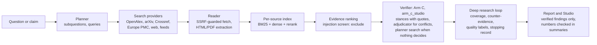

# Multi-Agent RAG — Research Studio


Multi-Agent RAG is an M.Tech research project on retrieval-augmented generation that checks its own claims. Language
models answer research questions fluently even when no source supports the answer. This project splits research into
separate, inspectable steps:
* a **planner** writes search queries;
* a **web researcher** reads scholarly and web sources;
* a **retrieval engine** ranks passages;
* a **synthesizer** drafts cited statements;
* a **verifier** checks every statement against the retrieved passages.

Only statements the verifier supports are reported as findings, and the sources, passages, conflicts and search limits
stay visible.

The software runs as a **local application on your own computer**, by default with the `qwen3:4b` model in Ollama.
Its verdicts are judgements by a language model about the retrieved text, not proof that a statement is true.

* **Public showcase:** https://multi-agent-rag-research.streamlit.app. It is a static website about the project: an
  overview, an architecture explorer computed from the source code, the research workflow with recorded
  demonstrations, the historical results with their methodology, the current evaluation status, what can be
  reproduced, installation instructions, and use cases and limits. It runs no model and starts no research.
* **The application:** the Research Studio and its dashboard, installed and run locally (below).

## Quick start (Windows)

```text
py -3.12 -m venv .venv
.venv\Scripts\python.exe -m pip install -r requirements.txt
ollama pull qwen3:4b
.\start_studio.bat
```

The launcher checks the setup, starts both parts and opens the dashboard:

| | Address | What it is |
|---|---|---|
| **Dashboard** | http://127.0.0.1:8501 | Streamlit command center: Command Center, Research Workspace, Research Library, Evidence Explorer, Model & Integrations, Settings & Diagnostics |
| **Research Studio** | http://127.0.0.1:8765 | the original Studio interface and the backend (API, job queue, pipeline) that the dashboard talks to |

In PowerShell keep the leading `.\`; in `cmd` it is optional. Both listen on `127.0.0.1` only. Stop both with **Ctrl+C**
in the launcher window.

## How a run works



* **Research questions.** The planner splits the question into subquestions and writes queries. The web researcher
  searches the active providers and reads the sources it can reach. Network access is guarded against private
  addresses and pinned to checked addresses. Wikipedia is not accepted as an evidence source.
* **Retrieval.** Each source is indexed separately (BM25, dense embeddings, cross-encoder reranking), and passages are
  ranked per question or claim.
* **Verification.** The synthesizer drafts cited statements, and the verifier judges each one against its passages
  (SUPPORTS / CONTRADICTS / NEUTRAL, with the sentence it relies on).
* **Verdicts.** SUPPORTED needs a supporting passage, CONTRADICTED a contradicting one, and anything else is
  INSUFFICIENT.
* **Deep research** (quick, standard and deep budgets) adds bounded search rounds, coverage per subquestion,
  counter-evidence searches, evidence-quality labels (single source, abstract only, independence unknown),
  deterministic cautions and a recorded reason for stopping.
* **Claim verification** (`--verify` or the Studio's verify mode) retrieves passages for one claim and returns its
  verdict with every passage's stance.
* **Reports.** Runs are saved with their stages, sources, passages, stances and limits, and can be exported as
  Markdown or JSON.

## Verification in the Research Studio

**Default verifier: Arm C agentic verification, Studio-adapted variant (`arm_c_studio`).** It runs the frozen code of
the project's agentic verification study, arm C (`docqa/agentic.py` over `evaluation/experiments/agentic_verify/`).
For each statement:
1. One verifier call judges the retrieved passages. Each decisive stance needs an exact quote from its passage.
2. If the passages agree, that is the verdict.
3. If passages conflict, an adjudicator decides which side tests the exact claim. The statement is then marked
   *adjudicated*, both sides stay listed, and a supported statement stays out of the direct answer and summary.
4. If no passage took a side, a planner may search the evidence already collected for this run (at most two searches,
   with no new web requests). New passages are judged the same way before adjudication.
5. Without a passage for or against the claim, nothing is decided: the statement stays INSUFFICIENT.
6. Failures are reported, never replaced by another verifier: a model-service error, unusable output, an invalid
   stance, or a failed or impossible search.

`arm_c_studio` differs from the historical method (`arm_c`, also selectable) in three fail-closed rules:
* no adjudicator decision is accepted without a passage for or against the claim (rule 5);
* an adjudication that cites a passage judged for the other side is not accepted; the study's rank rule decides
  instead;
* if the verifier gives a passage an invalid stance, the claim is not assessed, rather than read as neutral as in the
  study.

A passage the verifier's reply leaves out is still read as neutral, as in the study, because the model routinely omits
passages it finds irrelevant. Each omission is recorded with the verdict. An omitted passage that would have
contradicted the claim cannot be detected.

The last two rules were added on 2026-10-24 after an adversarial test campaign showed incomplete or contradictory
model output producing SUPPORTED. No evaluation data was involved.

Every claim records which verifier ran and a trace of its steps. Passages found by the planner's search are marked.

**Safeguards, on by default:**
* **Injection screen** (`exclude`). Retrieved passages that look like injected instructions are withheld from every
  model call, and the run records which passages were withheld.
* **Quote attestation** (record only). The position of each verifier quote in its passage is recorded. It never
  changes a verdict.
* **Fixed settings.** The verification settings are fixed when the Studio starts; a run request cannot change them.

**Alternative verifiers** (set `WEBRAG_VERIFIER`):
| Verifier | What it does |
|---|---|
| `arm_c` | the historical Arm C exactly, including adjudicator decisions made without any passage for or against |
| `arm_c0` | historical arm C0: adjudication without the planner's search |
| `quote_stance` | the previous default: one model call per passage; conflicting evidence stays INSUFFICIENT |
| `quote_stance_ranked` | `quote_stance`, with conflicting evidence decided by the first-ranked passage with a stance (not Arm C) |
| `quote_stance_adjudicated` | `quote_stance` with an adjudicator asked in both passage orders (not Arm C; it raised false support in exploratory runs, so it is not recommended) |
| `frozen_b` | the earlier Experiment B verifier |

## Results: historical studies and the current Studio

The project's benchmark results are **historical**. Each describes the system and data it was run on, not the current
Research Studio.

* **Agentic verification study (the origin of Arm C), run 2026-10-23.** It was a pre-specified paired comparison on
  the 188 labelled SciFact development claims (124 supported, 64 contradicted), which earlier project systems had
  already used, so they are not an untouched test set. Model `qwen3:4b`, one run per arm. The metric is two-class
  macro-F1 over all 188 claims, with INSUFFICIENT counted as an error.
  * Arm C reached macro-F1 0.7551 against 0.7153 for the single-pass rank baseline (B1R).
  * **This is a two-class figure.** Claims whose gold label is NOT_ENOUGH_INFO were not in the denominator. It cannot
    be compared with the three-class macro-F1 used for every Studio evaluation below; see
    `evaluation/studio_eval/TWO_VS_THREE_CLASS.md`.
  * The difference was +0.0398, with a paired 95% bootstrap interval of −0.0041 to +0.0850 and a permutation p of
    0.0813. It was **not statistically significant** at the pre-specified α = 0.05.
  * Arm C0, without the planner's search, scored 0.7576.
  * Arm C confirmed more contradicted claims: false support was 13/64 (20.3%) against 10/64 (15.6%).
  * Re-scoring the same recorded Arm C outputs with `arm_c_studio`'s rules gives 0.7528. This is a post-hoc,
    exploratory re-scoring, not an evaluation of `arm_c_studio`.
  * The aggregate figures, their definitions and caveats are in `showcase/data/historical_agentic_verification.json`.
    The project recomputed every figure from per-claim records with an independent re-scorer (all matched). Those
    records are not published while the SciFact licence terms are clarified, so a reader cannot yet recompute the
    figures from this repository.
* **Phase 11B benchmark** (systems B and C, `evaluation/experiments/results/phase11_final/`). On 176 paired SciFact
  development claims, both systems had a paired accuracy of 0.483 (exact McNemar p = 1.0): no statistically
  significant difference.
* **The Research Studio's own accuracy with `arm_c_studio` has not been evaluated.** No accuracy figure is claimed for
  it.
  * A frozen evaluation protocol, harness and scorer for it are in `evaluation/studio_eval/`: fixed evidence packets,
    macro-F1 with a bootstrap interval, and a promotion gate.
  * The annotation and freeze workflow is in the same folder: `ANNOTATION_GUIDE.md`, `DATASET_CONSTRUCTION.md` and
    `annotate.py`. It covers blinded task files, Cohen's kappa, third-person adjudication, and a `FREEZE.json` that the
    harness verifies.
  * The evaluation has not been run. It needs about 360 new claims with fixed evidence packets, labelled
    independently by two human annotators with a third-person adjudication: at least 300 claims and 100 per class
    after exclusions. No existing project claim set qualifies, and no model may supply the labels.
* **Alternative evaluations of the current verifier (2026-10-24; proxy, not the Studio's accuracy on its task).**
  The real `arm_c_studio` path (local `qwen3:4b`, injection screen and quote attestation on) ran on fixed packets of
  SciFact abstracts, under a plan frozen before the runs (`evaluation/studio_eval/ALT_BENCHMARKS.md`). Aggregates are
  in `showcase/data/studio_alt_evaluation.json`.
  * **Retrospective benchmark:** 300 SciFact TRAIN claims never used to develop Arm C (100 per class, SciFact's human
    labels, cited abstracts as the packet). 3-class macro-F1 0.5878, 95% bootstrap interval 0.5305 to 0.6421;
    accuracy 0.5867. False support 35/200 (19/100 among contradicted claims); missed contradiction 42/100; 44/100
    not-enough-information claims were decided anyway; 1 operational failure, counted as an error.
  * **Against the historical `arm_c` on the same packets:** 0.6123. The difference (−0.0245, paired interval −0.0628
    to +0.0138, permutation p 0.2326) is not significant. `arm_c_studio` declined 45 decisions made without a sided
    passage (`arm_c` got 23 of them right) and had less false support (35/200 against 42/200).
  * **Programmatic cases:** unrelated abstracts were recognised as not enough information in 89/100 cases;
    "It is not true that …" negations got the expected opposite label in 58/100.
  * **Adversarial cases:** an injected instruction asking for SUPPORTED was withheld in 30/30 packets and changed no
    verdict's correctness (17/30 correct with and without it).
  * **Repeatability:** 30/30 identical verdicts in a second run.
  * **Held-out test of the default (official SciFact DEV split, 300 claims, cited abstracts):** 3-class macro-F1
    0.5644, 95% interval 0.5073 to 0.6191; false support 30/176.
  * **Improvement attempt, not adopted.** `arm_c_studio_qr` repairs near-copy quotes that the strict quote check
    rejected (`docqa/agentic_candidates.py`; opt-in, not the default). It raised development macro-F1 from 0.5878 to
    0.6179. On the held-out split it scored 0.5558 against 0.5644 (Δ −0.0087, paired interval −0.0391 to +0.0216),
    and raised false support from 30/176 to 38/176. A larger local model (qwen3.5) was rejected on development:
    more false support, model failures and 2.7 times the runtime. Plan and decisions:
    `evaluation/studio_eval/IMPROVEMENT_PLAN.md`.
  * **Second round, also not adopted** (`evaluation/studio_eval/IMPROVEMENT_PLAN_2.md`). The model's reasoning mode
    was infeasible on the 4 GB GPU (600–700 s per claim). A revised verifier prompt raised macro-F1 on 90
    development claims (+0.0228, interval −0.0978 to +0.1401), but increased false support from 7/60 to 11/60, so it
    stopped at screening.
  * **Simpler verifiers on the same 300 development claims tie on macro-F1.** `quote_stance` scored 0.5983,
    `arm_c0` 0.6076, `arm_c` 0.6123 and `arm_c_studio` 0.5878; no paired difference is significant. (`arm_c0` is the
    2026-10-25 re-run with run identity. The earlier 0.5850 came from a file with duplicate records, which the
    duplicate policy rejects.) They differ in
    their errors: `quote_stance` has the least false support (26/200) but misses 74/100 contradictions; `arm_c0`
    misses the fewest (33/100) but has 42/200 false support; `arm_c_studio` lies between (35/200 and 42/100). The
    multi-step design changes the error trade-off; it does not raise accuracy here.
  * **Two metrics.** Every figure above is three-class macro-F1 (SUPPORTED, CONTRADICTED, NOT_ENOUGH_INFO; all
    claims). The historical study's two-class metric (SUPPORTED and CONTRADICTED claims only; deciding a claim that
    has no evidence is not penalised) gives higher numbers on the same records:

    | Set and run | Three-class | Two-class | NEI claims decided |
    |---|---|---|---|
    | `retro`, `arm_c_studio` | 0.588 | 0.692 | 44/100 |
    | `retro`, `arm_c0` | 0.608 | 0.758 | 59/100 |
    | SciFact DEV (`test_dev`; its 188 S/C claims are the historical study's), `arm_c_studio` | 0.564 | 0.658 | 49/112 |
    | Round-3 confirmation (249 claims), `arm_c_studio` | 0.501 | 0.674 | 77/164 |

    * Most of the distance between the historical 0.7551 and today's 0.50–0.61 is the third class.
    * The verifier's prompt was written for the two-class study. It pushes borderline passages to CONTRADICTS, and its
      most common three-class error is a NOT_ENOUGH_INFO claim called CONTRADICTED.
    * The 0.75 target in the improvement plans is three-class. No valid three-class run has reached it.
    * Definitions, every run and the caveats are in `evaluation/studio_eval/TWO_VS_THREE_CLASS.md`. Recompute with
      `python -m evaluation.studio_eval.historical_metric`.
  * These are scientific abstracts, not the web pages the Studio reads, and SciFact is public data, so these figures
    describe the verifier on a proxy task only. They are not the Studio's accuracy on its task.

### What can be reproduced from this repository

| What | Status |
|---|---|
| Phase 11B metrics | Recomputable: result files and per-claim records are in `evaluation/experiments/results/` |
| Agentic verification study figures | Readable as aggregates; **not recomputable** here (per-claim records withheld) |
| Inference re-runs of either study | Not complete: the study's retriever builder and run records are not included, and model outputs may differ |
| Research Studio accuracy | Not measurable yet: `evaluation/studio_eval/` holds a frozen protocol and harness, but no labelled claim set exists |
| Alternative (proxy) evaluations | Re-runnable: `python -m evaluation.studio_eval.alt_benchmarks build/run/score` rebuilds the sets from `data/scifact/` and re-runs them (needs Ollama with `qwen3:4b`; about 3 hours); outputs may differ slightly between runs |
| Software behaviour | Re-runnable: the offline tests (see Tests) |

## Prerequisites

* Windows 10/11 x64 and **Python 3.12** (`py -3.12 --version`). The pinned packages are for Python 3.12 on Windows.
* **Ollama** (https://ollama.com) with the model: `ollama pull qwen3:4b`. Without Ollama, the Studio and dashboard still
  start, show saved reports and say that the model is not reachable.
* Internet access for the search providers. The first research run downloads the two retrieval models
  (`all-MiniLM-L6-v2`, `cross-encoder/ms-marco-MiniLM-L-6-v2`, about 180 MB) into the Hugging Face cache.
* Node.js, only to run the interface tests.

## Install

```text
py -3.12 -m venv .venv
.venv\Scripts\python.exe -m pip install -r requirements.txt
```

`requirements.txt` lists the direct dependencies. `requirements-lock.txt` pins every package for Windows x64 /
Python 3.12; `pip install -r requirements-lock.txt` reproduces the tested environment exactly.

## Configure (optional)

Nothing needs configuring for the defaults. To change them, copy `.env.example` to `.env` (ignored by git), edit it,
and restart the launcher:

```text
copy .env.example .env
notepad .env
```

* **Another local model:** `WEBRAG_LLM_MODEL=llama3.2:3b` (pull it in Ollama first).
* **An OpenAI-compatible API or an Ollama server elsewhere:** set `WEBRAG_LLM_PROVIDER` (`openai` or `ollama`),
  `WEBRAG_LLM_BASE_URL` (`https://...`), `WEBRAG_LLM_MODEL` and, if needed, `WEBRAG_LLM_API_KEY`. Prompts, questions
  and retrieved passages are then sent to that service. The key stays in the Studio server process; the interfaces
  show only whether it is set.
* **Unavailable model:** the run stops with that reason. No other model or provider is substituted.
* **Verification:**
  * `WEBRAG_VERIFIER`: `arm_c_studio` by default; see the alternatives above.
  * `WEBRAG_INJECTION_GUARD`: `exclude` by default, or `flag` or `off`.
  * `WEBRAG_QUOTE_ATTESTATION`: on by default when the verifier quotes; `0` turns it off.

  The launcher prints what it will use, and an invalid value stops the start. A `python -m webrag.server` flag wins
  over the setting.
* **Search providers:** `OPENALEX_API_KEY`, `WEBRAG_CONTACT`, `SEARXNG_URL` and `BRAVE_API_KEY`; see `.env.example`.

The dashboard's *Model & Integrations* page shows the model, the active verification workflow and where each setting
came from, as the running Studio reports them. *Settings & Diagnostics* shows the configuration and data locations.

## Launch and stop

```text
.\start_studio.bat                                      # both parts, opens http://127.0.0.1:8501
.\start_studio.bat --no-browser                         # without opening a browser
.\start_studio.bat --studio-port 8766 --dashboard-port 8502
.\start_studio.bat --check                              # only check the setup
```

`start_studio.bat` runs `.venv\Scripts\python.exe -m dashboard.launch`. Stop it with **Ctrl+C** in its window; the
launcher stops both parts. Each part can also run on its own:

```text
.venv\Scripts\python.exe -m webrag.server                     # Research Studio only, http://127.0.0.1:8765
.venv\Scripts\python.exe -m streamlit run dashboard/app.py    # dashboard only (needs the Studio running)
.venv\Scripts\python.exe -m webrag "a research question"      # command line, no interface
.venv\Scripts\python.exe -m webrag --verify "a claim"
.venv\Scripts\python.exe -m streamlit run showcase/app.py     # the public showcase, locally
```

* **Saved runs** go under `outputs/webrag/runs/`. They are not versioned, because they contain fetched web text.
* **Command-line defaults.** The command-line tool keeps its own defaults (`quote_stance`, screen and attestation off),
  so earlier results stay reproducible.
* **More detail** (Studio options, deep research, network safety, evaluation): `webrag/README.md`.

## Troubleshooting

| Problem | What to do |
|---|---|
| `No virtual environment found` | create it: `py -3.12 -m venv .venv`, then install the requirements |
| `Missing packages: ...` | `.venv\Scripts\python.exe -m pip install -r requirements.txt` |
| `Ollama is not reachable` | start the Ollama app; `ollama list` should answer |
| `qwen3:4b is not installed` | `ollama pull qwen3:4b` (or set another installed model in `.env`) |
| `Port 8765/8501 is used by another program` | close that program, or `.\start_studio.bat --studio-port 8766 --dashboard-port 8502` |
| `Configuration problem: ...` | fix the named setting in `.env` (see `.env.example`) |
| dashboard shows *Studio backend is not running* | start with `.\start_studio.bat`, or start `python -m webrag.server` and reload |
| first run is slow or fails while loading models | the retrieval models are downloaded once; check the internet connection |
| a search provider fails (for example OpenAlex `429`) | the run continues with the others and lists the error; `OPENALEX_API_KEY` in `.env` avoids the shared budget |

## Tests

Offline, with no model and no network:

```text
.venv\Scripts\python.exe -m pytest -q
node --test tests/js/*.test.mjs
```

The tests cover:
* the pipeline, deep research and network safety;
* the Arm C integration: the real orchestration and HTTP API with scripted model replies;
* configuration, the dashboard and the showcase.

## Limitations

* **Model errors.** A 4B local model drafts and judges the statements, and it makes mistakes.
* **Strict quoting can miss true claims.** Arm C demotes a stance whose quote is not text of its passage. In a small
  live check, a true claim ended INSUFFICIENT because the model mis-copied its quote.
* **Adjudicated verdicts are less reliable.** In the historical study, the adjudicator raised false support. Here,
  adjudicated statements are marked, keep both sides and stay out of the direct answer, which reduces but does not
  remove this risk.
* **The injection screen withholds whole passages.** That includes any genuine evidence in the same passage, so
  evidence for or against a claim can be missing; the run's limitations say so. The screen matches fixed patterns and
  misses paraphrased attacks.
* **Quote checks in `quote_stance`.** Its quote check is tolerant. An exploratory replay found accepted quotes that
  were not contiguous text of their passage, for example mis-copied numbers. Quote attestation records this and does
  not change verdicts.
* **Search coverage** depends on what the providers return and what can be read; many sources are abstract-only.
* **Not for networks.** The Studio and dashboard bind to 127.0.0.1, have no authentication and are not meant to be
  exposed to a network.

## Repository layout

| Path | What it is |
|---|---|
| `webrag/` | the Research Studio: server, pipeline, deep research, sources, retrieval, reports, interface |
| `docqa/` | verifiers (including Arm C in `agentic.py`), model clients, document indexing and the document assistant |
| `dashboard/` | the local Streamlit dashboard and the launcher (`start_studio.bat` runs it) |
| `showcase/` | the public static showcase |
| `evaluation/` | experiment code, protocols and recorded results, including the frozen Arm C code |
| `evidence_core/` | evidence contracts, including span attestation |
| `tests/` | offline Python tests and interface tests (`tests/js/`) |
| root `*.py` files | the earlier research backend and benchmark scripts with their recorded results; they stay at the root because recorded manifests, provenance inventories and tests refer to them by path |

What each file is and which ones the application needs: `docs/REPOSITORY_STRUCTURE.md`. Frozen modules:
`ARCHITECTURE_DECISION_VERSION_BOUNDARIES.md`.

## Not included in this repository

These are kept private, and some documents refer to them by path:
* the thesis drafts;
* the agentic verification study's protocol, per-claim records and analysis (its frozen code and aggregate results
  are included);
* the evaluation command line and its held-out claim sets;
* evaluation run records;
* other unpublished research material.

## License

The project's own code and documentation are released under the MIT License (see `LICENSE`). The MIT License does not
cover third-party material in this repository, which keeps its own terms:
* `data/scifact/`: the SciFact dataset (claims and a corpus of scientific abstracts) by its original authors. Use it
  under the dataset's own licence and citation requirements, published with the dataset; this repository has not
  verified those terms.
* Titles, abstracts and other text of third-party publications that appear in data files or test fixtures remain the
  property of their authors and publishers.
* The Python packages in `requirements.txt` and `requirements-lock.txt` are not bundled; each is distributed under its
  own licence.
